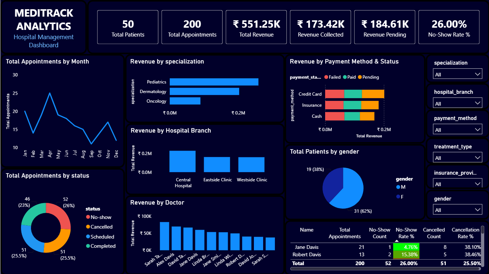

# MediTrack Analytics: Hospital Operations & Revenue Dashboard

An interactive Power BI dashboard that turns raw patient, doctor and appointment data into a single view of hospital performance. It tracks patient volume, revenue, pending payments, and appointment problems such as no-shows and cancellations, and compares doctors, specializations and branches.



## Headline Numbers

| KPI | Value |
|---|---|
| Total Patients | 50 |
| Total Appointments | 200 |
| Total Revenue (billed) | Rs. 551.25K |
| Revenue Collected | Rs. 173.42K |
| Revenue Pending | Rs. 184.61K |
| No-Show Rate | 26.00% |

## Key Insights

- **Revenue leakage is the biggest risk.** Only about 31% of billed revenue has been collected. Pending and failed payments make up the rest, likely due to insurance claim delays.
- **No-show rate is high.** About 1 in 4 booked appointments is a no-show. Combined with a 25.5% cancellation rate, roughly half of scheduled appointments never become a completed visit.
- **Doctor-level risk varies.** Three doctors show no-show rates of 32 to 36%, well above the 26% average.
- **Revenue is concentrated** at the Central Hospital branch and in the Pediatrics and Dermatology specializations.
- **Payment method matters.** Insurance and credit card payments show more pending status than cash.

## Dashboard Questions

| Chart | Question it answers |
|---|---|
| Line chart (Month × Appointments) | How do appointments trend month by month? |
| Donut chart (Status) | What share of appointments are completed, cancelled or no-show? |
| Bar chart (Specialization × Revenue) | Which specialization earns the most? |
| Column chart (Doctor × Revenue) | Which doctors generate the most revenue? |
| Stacked bar (Payment Method × Status) | Which payment methods are paid, pending or failed? |
| Pie chart (Gender) | What is the gender split of patients? |
| Column chart (Branch × Revenue) | Which branch performs best financially? |
| Table (Doctor × No-show / Cancelled rates) | Which doctors have high no-show or cancellation rates? |

Slicers: Specialization, Hospital Branch, Payment Method, Treatment Type, Insurance Provider, Gender.

## Data Model

A star schema built in Power BI:

- **Fact_Visits**: appointments merged with treatments and billing
- **Dimensions**: Patient, Doctor, Date (Dim_Date)

Source tables: patients, doctors, appointments, treatments, billing (50 patients, 10 doctors, 200 appointments).

Data cleaning in Power Query removed personally identifiable and non-analytical columns.

## Tools

Power BI Desktop · Power Query (M) · DAX · Star schema modeling

## Repository Contents

```
├── Hospital_mngt.pbix          # Power BI report
├── data/                       # Source data (or sample) and data notes
├── screenshots/                # Dashboard images
└── README.md
```

## How to Use

1. Download or clone this repository.
2. Open `Hospital_mngt.pbix` in Power BI Desktop.
3. If prompted, update the data source paths under **Transform data > Data source settings**.
4. Use the slicers to filter by branch, specialization, payment method and more.

## Recommended Actions

- Follow up on the Rs. 184.61K in pending revenue, starting with insurance and credit card transactions.
- Introduce SMS or call reminders to reduce the 26% no-show rate.
- Review scheduling load for doctors with above-average no-show or cancellation rates.

---

*Built by [Your Name] · [LinkedIn](https://linkedin.com/in/your-profile)*
